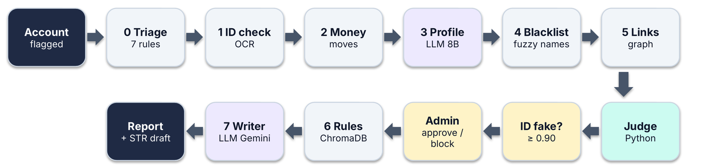
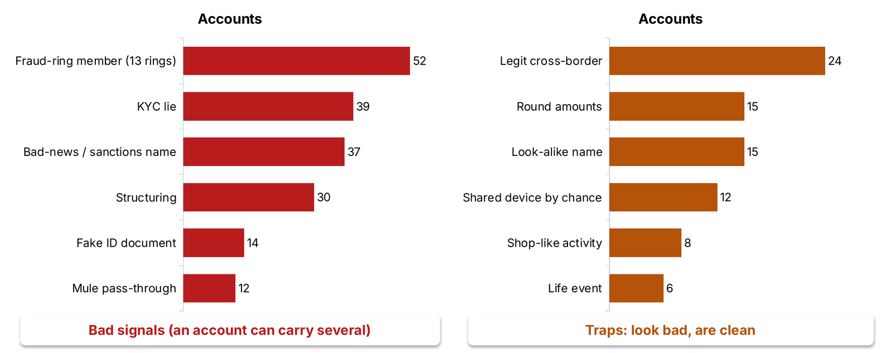
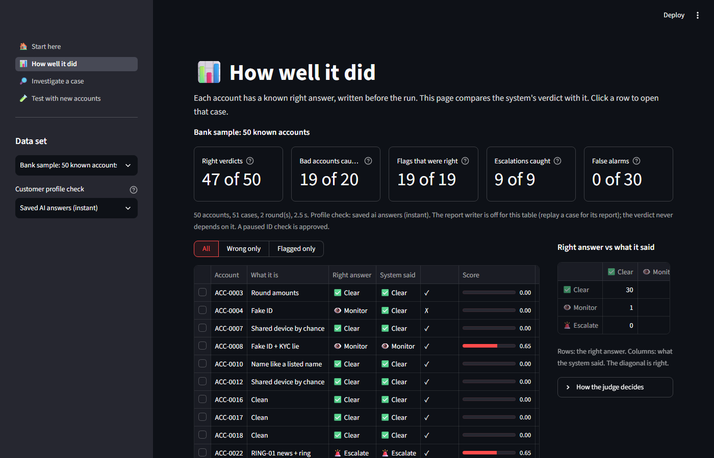
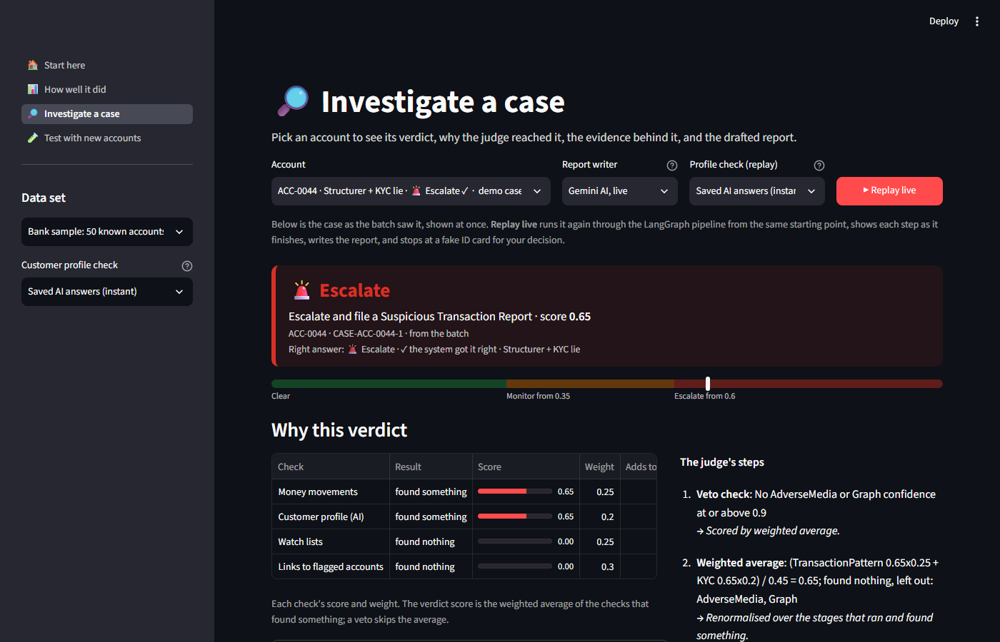
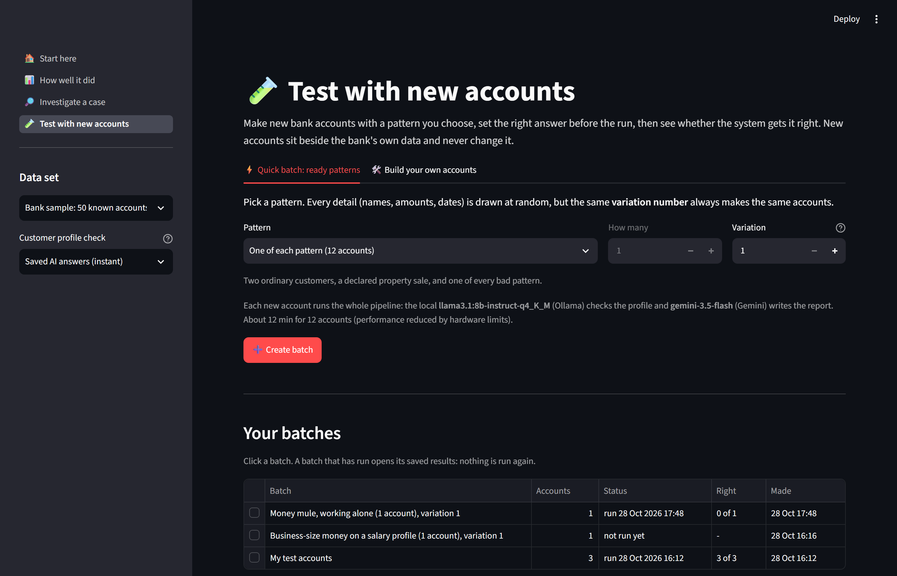

<div align="center">

# AML Auditor

**An explainable, multi-stage anti-money-laundering investigation assistant.**
Eight stages gather the evidence. A deterministic Python judge makes the call. Every verdict comes with its reasons.

[](https://github.com/ADG-007/multi-agent-aml-auditor/actions/workflows/ci.yml)


[](LICENSE)

</div>



## What it does

A bank's monitoring system raises an alert on an account. An analyst then has to decide whether to clear it, keep watching it, or escalate it and file a Suspicious Transaction Report (STR). AML Auditor automates the evidence gathering for that decision and writes the case file.

For each flagged account it:

1. Looks at the account from five angles: its ID document, its money movements, its stated profile, public watch lists and its links to other accounts.
2. Combines the results with a **deterministic judge written in plain Python**, so the verdict can be reproduced and audited.
3. Searches an AML rulebook and writes a report that may only cite the rules that were actually retrieved.
4. For escalated cases, drafts the STR for a human to review.

The bank in this repository is **fully synthetic**: 370 customers, 23,448 transactions, 740 ID images and 160 watch-list entries, all generated from a fixed seed. No real person or institution appears in it.

## Design principles

| Principle | What it means in the code |
|---|---|
| Scores are Python, never model arithmetic | Language models read text and pick a category. Code turns the category into a number and does all the maths. |
| The ID check never changes the score | Stage 1 can only pause the case for a human to approve or block. |
| Citations are checked | The report writer may cite only clause IDs returned by the rulebook search. A Python guard enforces this. |
| Failures degrade, they do not crash | A failed stage is marked `FAILED` and the case is floored at Monitor. |
| Every stage explains itself | Each stage output carries a `reasoning_trail`. |
| Private data stays local | The customer-profile model runs on your machine through Ollama. Only the final report writer calls a hosted model. |
| Reproducible | The data is seeded and committed. Model answers can be saved and replayed, so a full run needs no network. |

## The pipeline

| Stage | Job | Technique |
|---|---|---|
| 0 Triage | Seven cheap rules decide which accounts need a full look | Rule engine |
| 1 ID check | OCR reads the name and ID number on the ID image and checks them against the account record (no image forensics). A clear mismatch rates 0.95 forgery confidence, and 0.90 or more pauses the case for an admin. Never scored | Tesseract OCR, Pillow |
| 2 Money movements | Detects structuring (repeated amounts in the ₹9 to ₹10 lakh band) and pass-through accounts | Rule-based analysis of transactions |
| 3 Customer profile | Reads the KYC narrative and picks a risk level. Code maps the level to a score. If money in is at least 3 times stated income, the level is lifted to HIGH | Llama 3.1 8B (`llama3.1:8b-instruct-q4_K_M`) on Ollama |
| 4 Watch lists | Fuzzy-matches names against sanctions and adverse-media lists. A date-of-birth rule separates a true sanctions hit from a look-alike name | RapidFuzz |
| 5 Links | Finds shared devices, addresses and counterparties between accounts. A "no echo" rule stops one link from being counted twice | NetworkX |
| Judge | Combines stages 2 to 5 into one score and a verdict | Pure Python |
| 6 Rulebook search | Retrieves the three closest AML clauses | ChromaDB |
| 7 Report writer | Writes the case report and, for Escalate only, an STR draft. Falls back to a template if the model fails | Gemini (free tier) |

### How the judge decides

Only four stages are scored, each with a fixed weight: money movements 0.25, customer profile 0.20, watch lists 0.25 and links 0.30. Triage, the ID check, the rulebook search and the writer never feed the score.

- **Veto.** If Stage 4 (watch lists) or Stage 5 (links) reports confidence of 0.90 or more, the case escalates on its own without averaging.
- **Weighted average.** Otherwise the score is the weighted average of the stages that found something. A stage that found nothing is left out, and the weights are renormalised over the rest.
- **Bands.** Below 0.35 is **Clear**, 0.35 to 0.60 is **Monitor**, and 0.60 or more is **Escalate**.
- **Corroboration gate.** A score of 0.60 or more escalates only if two stages are at 0.40 or higher, or one stage is at 0.75 or higher while at least two stages found something. Otherwise the case stays at Monitor.
- **Floors.** A failed stage lifts a Clear to Monitor. So does any single stage at 0.40 or higher, so a real signal is never averaged away.

The same step functions run under two runners: a LangGraph `StateGraph` with an `interrupt()` for the admin gate, and a plain loop for batches. A batch re-checks accounts when new evidence appears, for at most six rounds.

## Results

Graded on a fixed 50-account subset of the synthetic bank (20 truly bad accounts, 30 clean ones, including deliberate look-alike traps).

| Measure | Result |
|---|---|
| Verdict exactly right | **47 of 50** |
| Bad accounts caught | 19 of 20 |
| Flagged accounts that were truly bad | 19 of 19 |
| Clean accounts wrongly flagged | **0 of 30** |
| Escalations that were required and made | 9 of 9 |
| Exactly right with no model at all | 45 of 50 |
| Exactly right on freshly generated accounts | 9 of 12 |

The "no model" row matters: the deterministic stages and the judge carry most of the result. The two language-model stages add the profile reading and the written report.



### Five show cases

| Account | What it shows | Outcome |
|---|---|---|
| `ACC-0044` | Two stages agree on a real problem | Escalate, with an STR draft |
| `ACC-0045` | Only the links stage fires | Monitor |
| `ACC-0346` | Shop-like activity that looks bad but is not | Clear |
| `ACC-0121` | Fake ID image | Pauses, then the admin decides |
| `ACC-0074` | Sanctions match with a matching date of birth | Veto at 0.95, Escalate |

## Quick start

Tested on Windows 11 with PowerShell and Python 3.14. Other systems should work but are not tested.

**You need**

- Python 3.14
- [Tesseract OCR](https://github.com/UB-Mannheim/tesseract/wiki) installed on the operating system and on your `PATH`
- [Ollama](https://ollama.com) for the local Stage 3 model
- A free [Gemini API key](https://aistudio.google.com/apikey) for the report writer (optional if you only want the template report)

```powershell
git clone https://github.com/ADG-007/multi-agent-aml-auditor.git
cd multi-agent-aml-auditor

python -m venv venv
venv\Scripts\activate
pip install -r requirements.txt

tesseract --version                       # check the OCR binary is found
ollama pull llama3.1:8b-instruct-q4_K_M   # about 5 GB, one time

copy .env.example .env                    # then put your key in .env

python -m src.generators.rulebook         # build the ChromaDB rulebook index
python -m src.generators.id_documents     # render the ID card images
python -m pytest -q                       # optional: run the tests
```

The index and the ID images are build outputs and are not committed, which is why the two generator commands are needed once.

### Run it

```powershell
python -m src.demo.cli run50       # grade the 50 accounts and print the scorecard
python -m src.demo.cli show        # the five show cases, with the live report writer
streamlit run src/demo/app.py      # the web app
```

| CLI command | What it does |
|---|---|
| `run50` | Grades the 50 accounts and writes `outputs/run50.jsonl` |
| `show` | Runs the five show cases with the live writer |
| `case ACC-xxxx` | Runs one account. `--admin ask` prompts for approve or block at a fake-ID pause |
| `kyc-precompute` | Runs Stage 3 alone in live mode and saves the answers |
| `generate`, `pack` | Create and run packs of new test accounts |

### The web app

| Page | Content |
|---|---|
| Start here | What the tool does, with the flow diagram |
| How well it did | Metric cards, a filterable table of verdicts and the confusion grid |
| Investigate a case | Verdict, score on the bands, why the judge decided, evidence tabs and the report. **Replay live** runs the case through LangGraph node by node and pauses at a fake ID |
| Test with new accounts | Build or generate fresh accounts and run them through the pipeline |







### Model modes

Both language-model stages can run in one of three modes. Saved answers are keyed on a SHA-256 fingerprint of the model, prompt version and input, so any change produces a fresh key.

| Mode | Behaviour |
|---|---|
| `off` | No model is called. Stage 3 contributes a neutral 0.0 and Stage 7 writes template text |
| `cached` | A matching saved answer is used. If none exists the stage fails loudly, never as a silent zero |
| `live` | A saved answer is used if present, otherwise the model is called and the answer is saved |

### Configuration

Secrets go in `.env`, which is gitignored. Never commit it.

| Variable | Purpose | Default |
|---|---|---|
| `GOOGLE_API_KEY` | Gemini key for Stage 7 | none |
| `AML_AUDITOR_MODEL` | Stage 7 model | `gemini-3.5-flash` |
| `AML_KYC_MODEL` | Stage 3 model | `llama3.1:8b-instruct-q4_K_M` |

## Project layout

```text
src/
  generators/      build the synthetic bank from a fixed seed
  schemas/         Pydantic contracts and every judge number
  bank/            BankData, the only door to the data
  matching/        the single fuzzy name matcher
  rulebook/        thresholds read from rulebook clauses
  llm/             model client, model config, saved answers, errors
  stages/          stage0_triage ... stage7_auditor
  scoring/         the judge
  orchestration/   steps, LangGraph graph, plain runner, run memory, batch
  evaluation/      the 50-account subset and grading
  demo/            command-line tool and Streamlit app
  newdata/         generated test-account packs
tests/             mirrors src/
data/              committed seeded bank (JSON, graph, rulebook source)
```

Code size: 89 source files (about 15,000 lines) and 40 test files (about 3,000 lines).

## Testing and linting

```powershell
python -m pytest -q      # 220 test functions in 40 files
ruff check .             # lint, configured in pyproject.toml
```

The test folders mirror the source folders, so each module's tests sit in the matching place under `tests/`.

## Limitations

- **Synthetic data only.** The results above describe this generated bank. They are not a claim about performance on real transactions.
- **Slow local model.** On a 4 GB GPU laptop Stage 3 takes about 20 seconds per account. Saved answers exist so demos and tests do not wait for it.
- **Tuned on this bank.** Thresholds were set against the seeded data. Real deployment would need recalibration on real alert history.
- **One free-tier writer.** Stage 7 depends on a free-tier Gemini model. When it is unavailable the template report is used.
- **Three of 50 verdicts are wrong** in the graded run. They are reported, not hidden. One example is `ACC-0004`, a fake ID with no other signal. It comes out Clear in the batch table, where a paused ID check is approved automatically.

## Responsible use

AML Auditor is a research and teaching project. It supports a human analyst and does not replace one. The STR draft is a draft: a trained officer must review it before anything is filed. Do not use it to make decisions about real people without proper validation, bias testing and legal review.

## Contributing

Issues and pull requests are welcome. Please read [CONTRIBUTING.md](CONTRIBUTING.md) first. To report a security problem, see [SECURITY.md](SECURITY.md).

## Authors

| GitHub | Role |
|---|---|
| [ADG-007](https://github.com/ADG-007) | Repository owner and main author |
| [Advay4706](https://github.com/Advay4706) | Contributor |
| [V1shalSukumar](https://github.com/V1shalSukumar) | Contributor |

## License

Released under the [MIT License](LICENSE).
